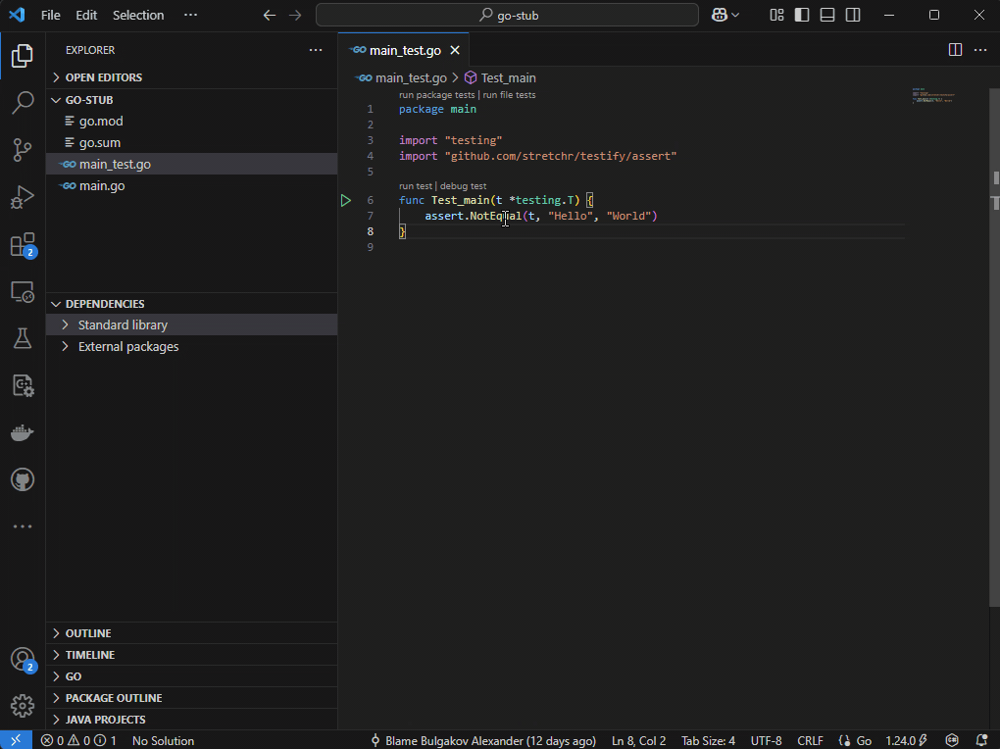

# Go Dependencies Explorer

*File explorer for quickly accessing Go package resources.*

A VS Code extension that adds an explorer view for browsing the Go standard library and external module packages — `.go` files, tests and everything else inside dependency sources.



## Features

- **Standard Library** — browse packages and files of the Go standard library (`GOROOT/src`).
- **External Packages** — browse packages of all modules used in the workspace (`go list -m all` + `GOMODCACHE`), with replaced modules shown on a separate root and module versions shown next to the package nodes.
- **Go to Package** — quick pick any dependency package by name or path and reveal it in the tree.
- **Editor sync** — opening a dependency file reveals it in the tree and marks it read-only for the session, so you do not accidentally edit a dependency.
- **Live refresh** — the view updates automatically when `go.mod`/`go.sum` change or workspace folders are added/removed (events are debounced into a single rescan).
- **Progress** — rescans show progress on the view itself.
- **Git guard** — a git repository accidentally opened inside package directories can be closed automatically.
- **Non-blocking** — `go` commands and directory scans run asynchronously, the extension host is never frozen.

## Setup

1. Install the extension (F5 in this repository, or install the packaged `.vsix`).
2. Have the [Go extension](https://marketplace.visualstudio.com/items?itemName=golang.go) installed — it provides the path of the `go` binary, and a Go toolchain on the machine.
3. Open a Go workspace: the **GO Dependencies** view appears in the Explorer.

## Commands

| Command | Description |
| --- | --- |
| `Go Dependencies: Refresh` | Rescan the standard library and module packages |
| `Go Dependencies: Go to Package` | Quick pick a package and reveal it in the tree (view title) |
| `Go Dependencies: Search in Dependencies` | Full-text search across all dependency directories |
| `Go Dependencies: Search in Directory` | Full-text search in the selected directory (context menu) |
| `Go Dependencies: Copy Path` | Copy the item's file path |
| `Go Dependencies: Copy Import Path` | Copy the Go import path of the selected directory (context menu) |
| `Go Dependencies: Open on pkg.go.dev` | Open the module documentation on pkg.go.dev (context menu) |
| `Go Dependencies: Open in Integrated Terminal` | Open a terminal in the selected directory |
| `Go Dependencies: Open in Workspace` | Add the selected directory to the workspace folders |
| `Go Dependencies: Reveal in File Explorer / Finder / Explorer View` | Reveal the item in the OS file manager |

## Settings

| Setting | Default | Description |
| --- | --- | --- |
| `go.dependencies.explorer.prevent.open.git.repo` | `ask` | Prevent opening git repositories located under "Standard Library" or "External Packages": `ask` shows a confirmation, `on` closes them silently, `off` disables the guard |

## Building and testing

```bash
npm ci
npm run compile       # esbuild bundle → dist/extension.js
npm run compile-tests # tsc → out/ (required before integration tests)
npm run unit          # unit tests (vitest)
npm run coverage      # unit tests + coverage report
npm run test          # unit + bundle + integration tests (@vscode/test-electron)
npm run package       # prepublish chain + vsce package → .vsix
```

Debug with F5 (Run Extension). The integration tests use the stub Go workspace in `goWorkspace/go_stub`.

## License

MIT
