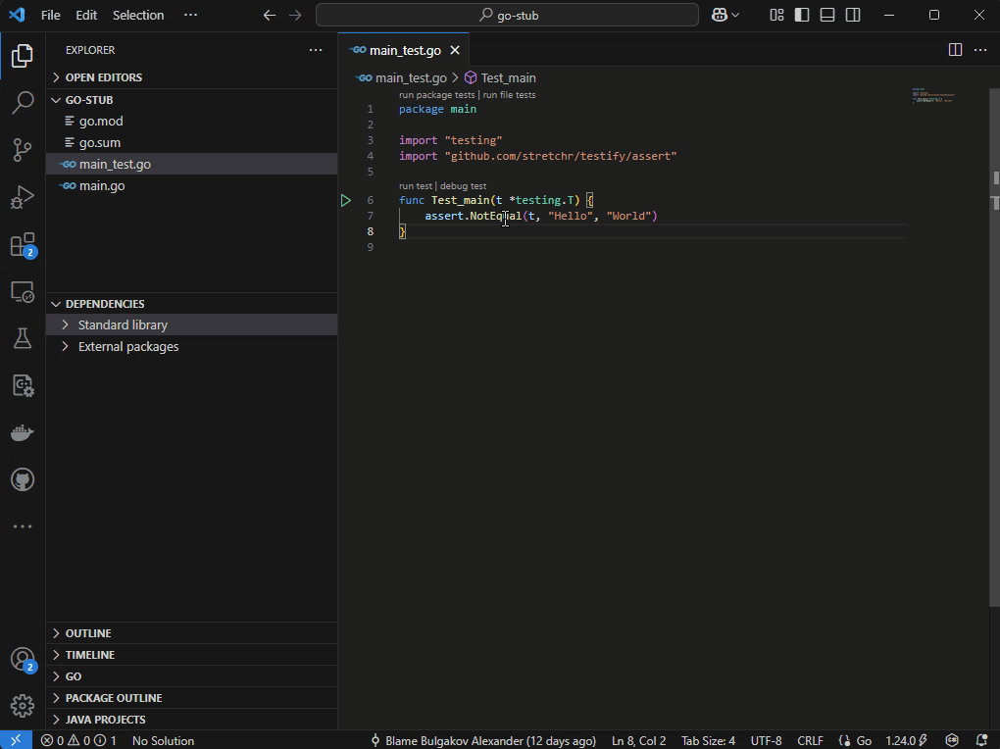

# Go Dependencies Explorer

*File explorer for quickly accessing Go package resources.*

A VS Code extension that adds an explorer view for browsing the Go standard library and external module packages — `.go` files, tests and everything else inside dependency sources.



## Features

- **Standard Library** — browse packages and files of the Go standard library (`GOROOT/src`).
- **External Packages** — browse packages of all modules used in the workspace (`go list -m all` + `GOMODCACHE`), with replaced modules shown on a separate root and module versions shown next to the package nodes.
- **Module updates** — the `Check for Module Updates` command queries available updates (`go list -m -u all`) and shows them next to the current version (`v1.2.3 → v1.4.0`). Enabled by default (`check.module.updates`); a custom `GOPROXY` (e.g. a corporate mirror) can be set with `go.dependencies.explorer.updates.goproxy`. By default `updates.autoCheck` re-runs the check hourly (`updates.autoCheck.intervalHours`, persisted across sessions, silent on network failures).
- **Go to Package** — quick pick any dependency package by name or path and reveal it in the tree.
- **Editor sync** — opening a dependency file reveals it in the tree and marks it read-only for the session, so you do not accidentally edit a dependency.
- **Persistent expand state** — expanded tree nodes are remembered per workspace and restored in the next session.
- **Live refresh** — the view updates automatically when `go.mod`/`go.sum` change or workspace folders are added/removed (events are debounced into a single rescan).
- **Scan cache** — package directory scans of the standard library and `GOMODCACHE` modules are cached per session; those trees are immutable (module versions live in directory names), so incremental refreshes rescan only replaced/local dirs. The `Refresh` command always performs a full rescan and resets the cache; the cache can be disabled with `go.dependencies.explorer.use.scan.cache`.
- **Modified package restore** — files in `GOMODCACHE` are occasionally changed by accident; every refresh runs `go mod verify` and modified modules can be restored to their pristine copies by re-downloading them (see the `modified.packages` setting).
- **Progress** — rescans show progress on the view itself.
- **Git guard** — a git repository accidentally opened inside package directories can be closed automatically.
- **Import link control** — on first startup (while the setting is not chosen) the extension makes Ctrl+Click on import paths jump to the package source instead of opening pkg.go.dev (sets gopls `importShortcut` to `Definition`, disables the "Open pkg.go.dev" editor command, restarts the language server) and asks whether to keep it; the choice persists in `block.import.doc.links` (`on`/`off`).
- **Non-blocking** — `go` commands and directory scans run asynchronously, the extension host is never frozen.

## Setup

1. Install the extension (F5 in this repository, or install the packaged `.vsix`).
2. Have the [Go extension](https://marketplace.visualstudio.com/items?itemName=golang.go) installed — it provides the path of the `go` binary, and a Go toolchain on the machine.
3. Open a Go workspace: the **GO Dependencies** view appears in the Explorer.

## Commands

| Command | Description |
| --- | --- |
| `Go Dependencies: Refresh` | Rescan the standard library and module packages |
| `Go Dependencies: Go to Package` | Quick pick a package and reveal it in the tree (view title) |
| `Go Dependencies: Check for Module Updates` | Query available module updates and show them in the tree (view title, opt-in) |
| `Go Dependencies: Search in Dependencies` | Full-text search across all dependency directories |
| `Go Dependencies: Search in Directory` | Full-text search in the selected directory (context menu) |
| `Go Dependencies: Copy Path` | Copy the item's file path |
| `Go Dependencies: Copy Import Path` | Copy the Go import path of the selected directory (context menu) |
| `Go Dependencies: Open on pkg.go.dev` | Open the module documentation on pkg.go.dev (context menu) |
| `Go Dependencies: Open in Integrated Terminal` | Open a terminal in the selected directory |
| `Go Dependencies: Open in Workspace` | Add the selected directory to the workspace folders |
| `Go Dependencies: Reveal in File Explorer / Finder / Explorer View` | Reveal the item in the OS file manager |

## Settings

| Setting | Default | Description |
| --- | --- | --- |
| `go.dependencies.explorer.prevent.open.git.repo` | `ask` | Prevent opening git repositories located under "Standard Library" or "External Packages": `ask` shows a confirmation, `on` closes them silently, `off` disables the guard |
| `go.dependencies.explorer.use.scan.cache` | `true` | Cache package directory scans of the standard library and `GOMODCACHE` modules between refreshes. Set to `false` to perform a full rescan on every refresh |
| `go.dependencies.explorer.check.module.updates` | `true` | Allow querying available module updates (manually and, if `updates.autoCheck` is enabled, on a schedule). Requires network access to the module proxy |
| `go.dependencies.explorer.updates.goproxy` | *(empty)* | `GOPROXY` override for the module update check — a corporate mirror URL, a comma-separated fallback list, `direct` or `off`. Empty uses the go toolchain default |
| `go.dependencies.explorer.updates.autoCheck` | `true` | Re-run the module update check once per interval instead of only manually. Requires `check.module.updates`; network failures stay silent |
| `go.dependencies.explorer.updates.autoCheck.intervalHours` | `1` | Hours between automatic update checks (1–168). The timestamp persists across sessions; a manual check resets the schedule |
| `go.dependencies.explorer.block.import.doc.links` | `off` | Control auto-opening of pkg.go.dev on Ctrl+Click over import paths. When never set, the extension asks on first startup: `on` keeps gopls `importShortcut` at `Definition` (jump to source) and the "Open pkg.go.dev" editor command disabled, restarting the language server after changes; `off` leaves the editor behavior untouched |
| `go.dependencies.explorer.modified.packages` | `ask` | Detect dependency packages modified in `GOMODCACHE` (`go mod verify` on every refresh) and restore their pristine copies by re-downloading the module: `off` ignores modifications, `auto` restores silently, `ask` shows a warning offering to restore the first detected module, all of them, or ignore |

## Building and testing

```bash
npm ci
npm run compile       # esbuild bundle → dist/extension.js
npm run compile-tests # tsc → out/ (required before integration tests)
npm run unit          # unit tests (vitest)
npm run coverage      # unit tests + coverage report
npm run test          # unit + bundle + integration tests (@vscode/test-electron)
npm run package       # prepublish chain + vsce package → .vsix
```

Releases publish the built `.vsix` to the VS Code Marketplace (`VSCE_PAT` secret) and to the Open VSX Registry for VSCodium and other editors (`OPEN_VSX_TOKEN` secret) from the `Handle Release` workflow.

Debug with F5 (Run Extension). The integration tests use the stub Go workspace in `goWorkspace/go_stub`.

## License

MIT
